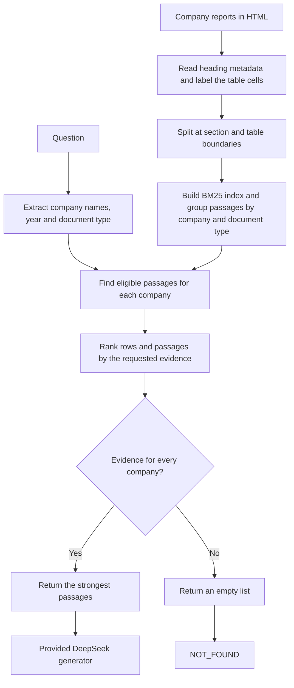

# FTEC5660 Homework 4

Run with Python 3.10 or newer and set `DEEPSEEK_API_KEY` in your environment or in a local `.env` file.

```bash
python -m pip install -r requirements.txt
python hw4.py --data-folder public_test
python run_ablation.py --data-folder public_test --final-results results.csv --output-dir . --write-readme README.md
```

The first run writes `results.csv`. The second measures B0 through V6, with V6 using the same final retrieval path as `hw4.py`. It writes `ablation_results.csv` and `ablation_metrics.csv`. Add `--offline` to measure retrieval without calling the generator.

## Homework 4 solution



I attach the table caption, row label and column header to the values before splitting the HTML. Chunks stay within one section or table and carry the company, source, fiscal year and document type. BM25 indexes the text, and the metadata routes the question to the right reports. An annual table can supply the previous year's figures, while a dated question about an officer uses the report for the requested year. For a comparison I look for evidence for each company separately. I give extra weight to exact table rows and to phrases that match the question's metric or qualifiers. If a company, year or required piece of evidence is missing, the retriever returns an empty list.

### Ablation study

<!-- hw4-results-start -->
| Variant | One change from the previous row | Recall@5 | Kept | Rejected | Answer accuracy |
| --- | --- | ---: | ---: | ---: | ---: |
| B0 | Plain text, recursive splits, whole-corpus BM25 | 14/46 (30.4%) | 46/46 | 0/14 | 27/60 (45.0%) |
| V1 | Preserve table captions and label every cell | 14/46 (30.4%) | 46/46 | 0/14 | 28/60 (46.7%) |
| V2 | Split at section and table boundaries | 9/46 (19.6%) | 46/46 | 0/14 | 22/60 (36.7%) |
| V3 | Route by company, year and document type | 32/46 (69.6%) | 46/46 | 0/14 | 46/60 (76.7%) |
| V4 | Rank by row labels and other evidence in the passage | 46/46 (100.0%) | 46/46 | 0/14 | 60/60 (100.0%) |
| V5 | Keep only the strongest passages | 46/46 (100.0%) | 46/46 | 0/14 | 58/60 (96.7%) |
| V6 | Abstain when eligible evidence is missing | 46/46 (100.0%) | 46/46 | 14/14 | 59/60 (98.3%) |

All variants use the same 60 public questions and the same BM25 settings. Recall@5 requires every evidence item for a question. Kept counts answerable questions with evidence returned, and rejected counts unanswerable questions with an empty result. V6 preserved 100.0% of scored table cells and passed 40/40 document checks. B0 produced 290 chunks and V6 produced 865.

Answer accuracy comes from the provided DeepSeek generator and grading functions. Identical questions with identical formatted contexts share a response. The detailed rows are in [ablation_results.csv](ablation_results.csv). The official final run is in [results.csv](results.csv).

#### What each change did

- **V1** Row labels and units remained attached to the corresponding values. Retrieval hits stayed at 14. Correct answers went from 27 to 28.
- **V2** Section boundaries separated table rows from company names on the cover. Global BM25 still needed metadata to recover that connection. Retrieval hits fell from 14 to 9. Correct answers went from 28 to 22.
- **V3** Company and report-year filters narrowed the search, and comparison questions received passages from both companies. Retrieval hits rose from 9 to 32. Correct answers went from 22 to 46.
- **V4** The score favoured a matching row or statement over a passage with only scattered query words. Retrieval hits rose from 32 to 46. Correct answers went from 46 to 60.
- **V5** Shorter contexts kept the most specific evidence and made fewer competing columns and figures visible to the generator. Retrieval hits stayed at 46. Correct answers went from 60 to 58.
- **V6** The evidence check handled unavailable companies, years and metrics before calling the generator. Retrieval hits stayed at 46. Correct answers went from 58 to 59. It rejected 14 of 14 unanswerable questions.

#### Error analysis

- **q003** asks “Which company had more employees at 31 December 2024: Northgate Payments or Northgate Robotics?” B0 missed at least one required fact. V6 found the evidence in `doc_028.html;doc_039.html`.
- **q004** asks “Which company had the higher net income in FY2024: Kestrel Semiconductor or Halcyon Freight?” B0 missed at least one required fact. V6 found the evidence in `doc_005.html;doc_008.html`.
- **q007 (broker rating).** V6 retrieved the right report for Brightwater Energy, and the investment summary says “We reiterate our BUY rating.” The summary does not name Kowloon Peak Securities. V4 also supplied a passage that identifies the broker and an explicit “Rating: BUY” line. V4 answered correctly, while V5 and V6 answered `NOT_FOUND`. This suggests that reducing the context removed the attribution needed to use the rating.
- **q044 (company outside the corpus).** V5 returned `231.3` from Orchid Bay Hotels when the question asked about Orchid Bay Resorts. V6 found no match for the requested company and returned an empty list, which gave the correct `NOT_FOUND`.
- V4 answered 60/60 correctly, with the generator handling the 14 unanswerable questions after retrieval. V6 answered 59/60 correctly and rejected all 14 before generation. I kept V6 because Task 3 grades whether the retriever abstains, and the narrower context cuts the number of passages sent to the generator.
<!-- hw4-results-end -->

## Task 6 reflection

[Someone You Can Count On (PDF)](reflection.pdf)
